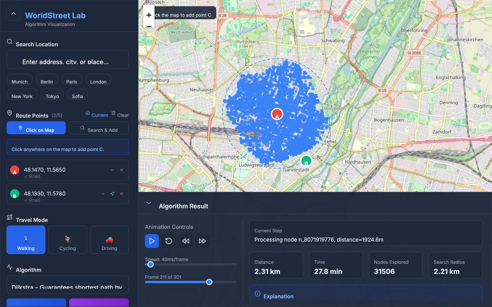
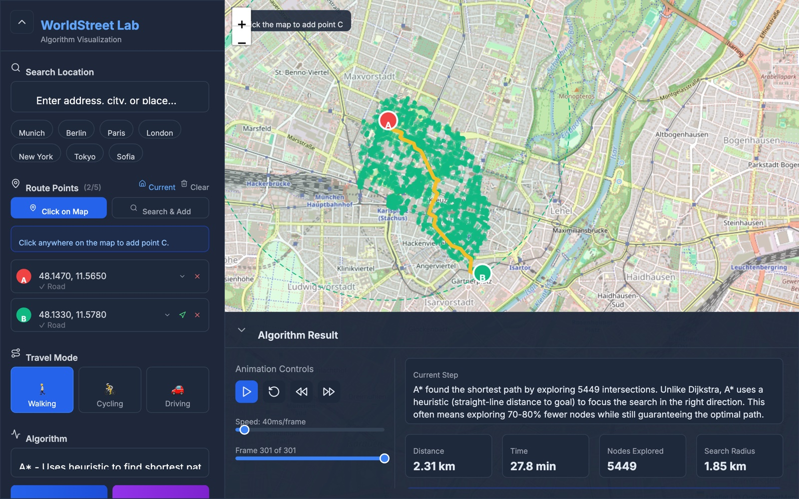
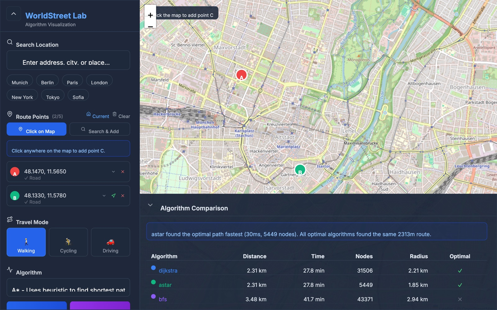

# Pathrithm — WorldStreet Algorithm Lab

Watch classic pathfinding algorithms search **real city streets**. Pick two points anywhere in the world, choose an algorithm and a travel mode, and Pathrithm downloads the street network from OpenStreetMap, runs the search, and animates every intersection it explores until it finds the route.

> [!NOTE]
> **The source code of this project is private.** This repository is its public showcase: the
> README, screenshots and every source file with its types and function signatures, but none of the
> code inside them. If you'd like a demo or to talk about the project, open an issue.



## Features

- **Real street networks** from OpenStreetMap, built separately for walking, cycling and driving (one-way streets respected when driving)
- **Six algorithms**: Dijkstra, A\*, BFS, DFS, Greedy Best-First and Bidirectional Dijkstra
- **Animated search**: explored intersections, the current frontier, the node being expanded and a growing search-radius circle, then the final route in yellow
- **Playback controls**: play/pause, step, scrub and change speed
- **Side-by-side comparison** of distance, travel time, nodes explored and search radius
- **Area filter**: draw a circle, rectangle or polygon to restrict where the algorithm may search
- **Point snapping**: clicked points snap to the nearest usable road within 200 m
- **Place search** (Nominatim) and quick jumps to Munich, Berlin, Paris, London, New York, Tokyo and Sofia

| A\* finds the shortest route while exploring far less | Comparing algorithms on the same trip |
| --- | --- |
|  |  |

## Algorithms

| Algorithm | Shortest route? | How it explores | Map colour |
| --- | --- | --- | --- |
| Dijkstra | Yes | Expands outward in order of distance — a circular wave | Blue |
| A\* | Yes | Like Dijkstra, but guided toward the goal by straight-line distance | Green |
| Bidirectional Dijkstra | Yes | Two Dijkstra waves, from start and goal, that meet in the middle | Cyan |
| BFS | No (fewest road segments) | Layer by layer, ignoring segment length | Purple |
| Greedy Best-First | No | Always moves to whatever looks closest to the goal | Red |
| DFS | No (often very long) | Follows one branch as deep as possible before backtracking | Orange |

On the example above (2.3 km walk across central Munich), Dijkstra and A\* return the same 2.31 km route, but A\* explores about 5,400 intersections instead of 31,500.

## Using it

1. Click the map to place **A** (start) and **B** (destination), or use **Search & Add**.
2. Choose a travel mode and an algorithm.
3. Press **Run** to animate one algorithm, or **Compare** to run Dijkstra, A\*, BFS and Greedy on the same trip.
4. Use the bottom panel to replay, scrub and read the metrics.

**The first run in a new area takes 20–60 seconds** while the street network downloads from OpenStreetMap's Overpass servers. After that it is cached on disk, so later runs in the same area, in any travel mode, take about a second.

## How it works

```
click A, B ──► area around the points (+800 m)
                 │
                 ▼
     cached on disk? ──no──► download from Overpass (falls back to mirror servers)
                 │                         │
                 ▼                         ▼
     street graph for the travel mode ◄── save to backend/.osm_cache
     (largest connected network only)
                 │
                 ▼
     snap A and B to the nearest usable road (≤ 200 m)
                 │
                 ▼
     run the algorithm, recording every expansion
                 │
                 ▼
     sample ~300 animation frames + coordinates ──► frontend animates them
```

- **Graph store** (`backend/app/graph/store.py`): areas are aligned to a grid and any cached area that covers the request is reused, in memory and on disk.
- **Connectivity**: fragments cut off at the edge of the download area are dropped, so a snapped point can always reach the other one.
- **Limits**: a request may cover up to about 40 km² of streets, which means keeping points within a few kilometres of each other. Bigger areas routinely time out on the public Overpass servers.

## Project structure

```
Pathrithm/
├── backend/
│   ├── app/
│   │   ├── main.py              # FastAPI app
│   │   ├── api/
│   │   │   ├── routes.py        # Endpoints, animation frames
│   │   │   └── schemas.py       # Request/response models
│   │   ├── graph/
│   │   │   ├── builder.py       # Overpass download, graph building
│   │   │   ├── store.py         # Area + travel-mode graph cache
│   │   │   ├── snapping.py      # Snap points to roads
│   │   │   └── models.py        # Node, Edge, StreetGraph
│   │   ├── algorithms/          # dijkstra, astar, bfs, dfs, greedy, bidirectional
│   │   └── utils/               # haversine, geometry
│   ├── requirements.txt
│   └── Dockerfile
├── frontend/
│   ├── src/
│   │   ├── App.tsx              # Map, controls, animation
│   │   └── lib/                 # API client and types
│   ├── vite.config.ts
│   └── Dockerfile
├── docs/screenshots/
└── docker-compose.yml
```

## Tech stack

- **Backend**: Python 3.12, FastAPI, HTTPX
- **Frontend**: React 18, TypeScript, Vite, Leaflet / React-Leaflet, Tailwind CSS, Framer Motion
- **Data**: street networks from [OpenStreetMap](https://www.openstreetmap.org/copyright) via the Overpass API; map tiles © OpenStreetMap contributors

## License

© 2026 Christo Dontchev. All rights reserved. The source code is private and is not licensed for
use, copying or distribution; see [LICENSE](LICENSE).
